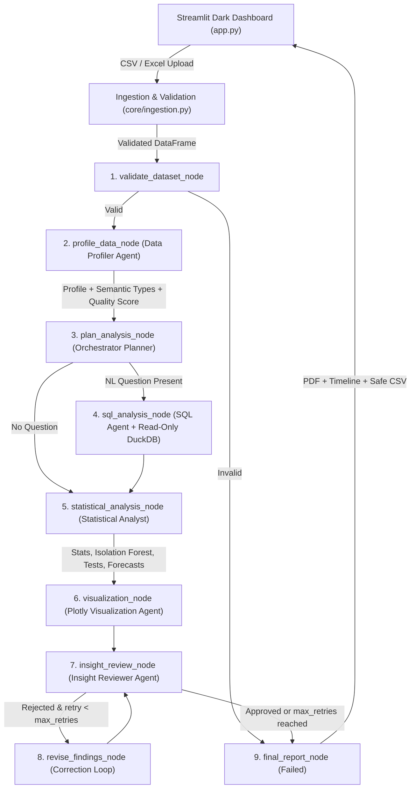
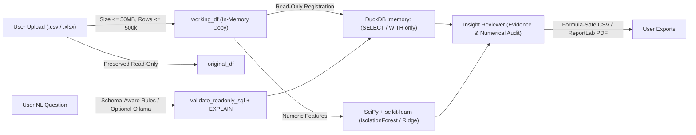
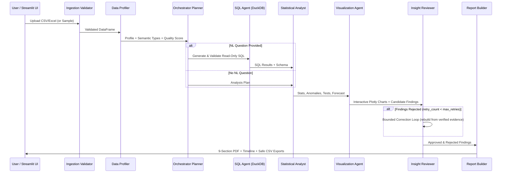

# DataMind AI — System Architecture & Data-Flow Diagrams

## 1. Multi-Agent System Architecture (LangGraph)

## 2. Data-Flow & Security Boundary Diagram

## 3. Agent-Interaction Sequence Diagram

